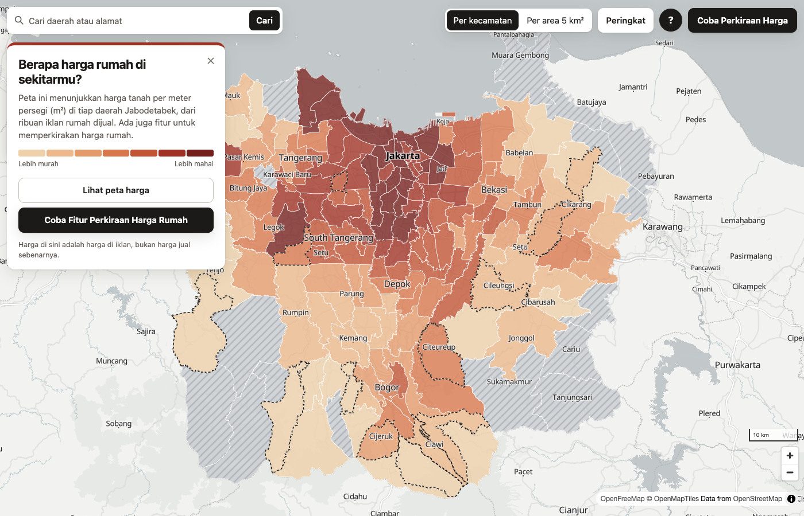
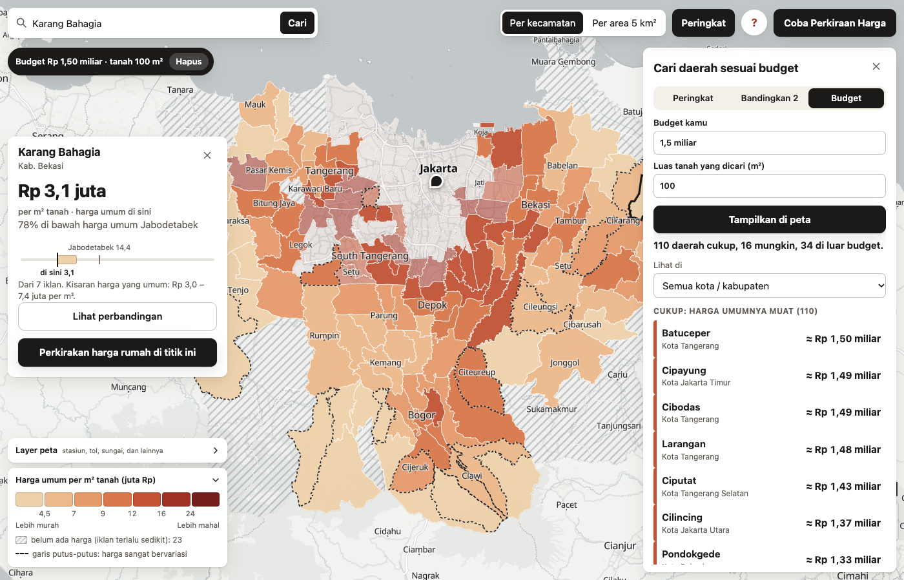
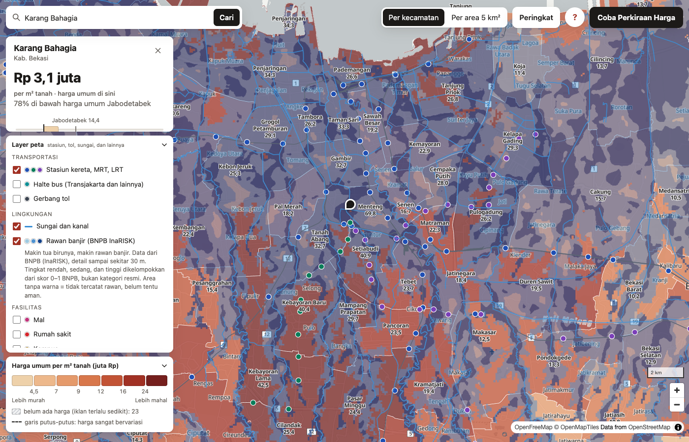
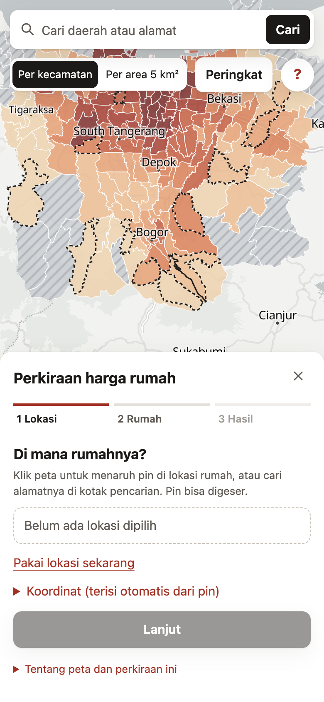

# Jabodetabek House Price

An asking-price map and estimator for houses in Jabodetabek (Jakarta, Bogor, Depok, Tangerang, Bekasi): where prices per m² of land sit,
and what a house like yours would ask, with an honest range around the number.

**Live demo:** [harga-rumah-jabodetabek.rlukafiardi.workers.dev](https://harga-rumah-jabodetabek.rlukafiardi.workers.dev) (in Bahasa Indonesia, free to use).
**Model card:** [docs/model-card.md](docs/model-card.md).

## The site
A static page in plain, casual Bahasa Indonesia (MapLibre on a free OpenStreetMap-based basemap, no build step, served from Cloudflare). It is written for
people who have never seen the data, so it avoids statistics words and says what a number means next to it.

- **Price map.** Median price per m² of land by kecamatan, with a finer 5 km² view. One warm sand-to-deep-red ramp in seven equal-count classes; hatched
  where there are too few listings to show a price; dashed outlines where prices are mixed. The legend is interactive: point at a tier and the rest fades.

- **Find, rank, compare, budget.** Search matches kecamatan names while you type and looks up addresses only on Enter (the free geocoder's policy forbids
  search-as-you-type, so results are cached and spaced out). A ranking panel lists areas by price and filters by city or regency; two or three areas can be
  compared side by side; and a budget filter lights up the areas where a typical house on your land size fits what you can spend.

- **Layers to consider.** Stations (KRL, MRT, LRT) and rail lines, bus stops, toll gates, rivers, malls, hospitals and universities from OpenStreetMap, and a flood
  hazard layer from BNPB's InaRISK at its own 30 m detail (a 0.2 MB image). The three flood levels are grouped by me from BNPB's 0 to 1 index and the legend
  says so; blank means "not marked as hazardous", not "safe".

- **Estimate in three steps.** Place a pin (click, search, or the browser's location), describe the house, read the result: a price, the range it usually falls
  in, and a bar that shows the wider possible range. Beside it: **what pushes the price up or down** compared with a typical house, a box to **compare an
  ad price** with the estimate, and a **share link** that reopens the same estimate. Warnings (take-over listings, auctions, large plots) are plain
  sentences, and the form refuses impossible values (no negative rooms) with a message under the field.

- **Phone first.** Panels become bottom sheets and the toolbar stays on one row. A browser test drives all of this in real Chrome, on a phone viewport too
  ([web/](web/)), and runs against the live site under its real security headers.

## Result
On 562 listings the final model never saw (set aside before the final model was chosen, scored once):

| | Median error | 95% interval |
|---|---|---|
| **Final model** | **22.7%** | 20.9 to 25.1% |
| Previous single XGBoost | 25.1% | 22.2 to 28.8% |
| Kecamatan median (best simple baseline) | 28.0% | 25.5 to 29.6% |
| City median | 35.8% | 31.5 to 39.8% |

The estimate comes with a likely range (50%) and a possible range (80%). On the holdout they covered 52.3% and 80.6% of actual
prices, close to their targets. The error is mostly information, not algorithm: listings carry no photos, condition or street width,
and the same house listed twice differs by only about 6%, so the limit is what the data can tell, not agent noise.

## What I did and why it can be trusted
- **Honest validation.** Random 5x5 CV and spatial-block CV (11 km blocks, because price similarity vanishes by about 10 km) reported
  together. Every comparison is paired on identical folds, and a change is adopted only if it wins in at least 4 of 5 repeats under
  both schemes. The final holdout was set aside before model selection and scored once; an earlier test set had already been spent on an
  earlier model, so the final one comes from newer listings.
- **Audits after the score.** Same-house leakage (listings of one house on both sides of a split) costs 0.1 to 0.3 points; a time-based
  backtest shows no staleness within one to four months; the model beats the portal's own price estimate overall (20.1% against
  23.4% on the same listings), though that estimate may have seen the asking price.
- **Ideas that did not work are kept in the record.** Neighbour prices, size ratios, population and wealth rasters, filling missing
  floors, land title: each tried, measured and dropped ([reports/tables/experiments.csv](reports/tables/experiments.csv)).

- **Model.** Mean of XGBoost, extra trees and ridge on 48 features (distances to rail, busway and Monas, OpenStreetMap context such as
  roads and land use within 500 m, size and rooms, agent-filled specs) plus a text score from the title and description. Target is
  log price per m² of land, so the price is land area times the prediction.
- **Ranges.** Split-conformal ranges from out-of-fold spatial errors, by city, with a wider band for plots over 300 m².
- **Explaining one estimate.** Each group of inputs (location, surroundings, land, building, rooms, floors, notes, details) is swapped for the typical
  house's values and the three-model estimate re-run; the change is that group's effect. It is approximate (inputs are correlated, so effects do not add up)
  and the page says so.
- **Error analysis.** The worst 10% of listings carry 40% of the error: the cheapest quarter is over-predicted, plots over 300 m² are
  hardest, and listings with missing floors are noisier ([error analysis](reports/tables/error_analysis.csv)).
- **Serving.** A FastAPI service computes the same features as training (a parity test checks 40 real listings to 1e-9) and runs on Google Cloud Run
  (Jakarta region, one small instance) from a Docker image of about 300 MB compressed. An estimate takes about 0.3 s there, measured from the request
  log; the global request cap is sized from that number so a public service stays inside the free tier.
- **Security review before launch.** I probed the API with hostile input and fixed what it found: NaN and Infinity gave a server error (now a 422), there
  was no body-size limit (now 32 KB), the per-client rate limit could be bypassed with a forged header when the service is reached directly (so there is also a
  global cap, and a post-deploy check confirms the real client address is used behind Cloud Run), and the image ran as root (now a normal user). The site
  sends a strict Content-Security-Policy and the browser test runs under it. Dependencies are clean (`pip-audit`, `npm audit`). Measured, not assumed: about 1,000
  queries are enough to clone the model to within about 4%, which no public estimate API can prevent, so the defence is bounding cost; and the served model
  does not reproduce training listings (its error on them is the same as on unseen houses).
- **Monitoring.** A weekly health report scores the live model on newly listed houses (the asking price is known at once) with
  alerts for error, bias, input drift and parse failures, tested by a quiet replay and a forced failure
  ([example](reports/figures/weekly_error.png)).
- **Engineering.** 64 tests plus 21 site tests and an end-to-end browser test, CI on Google Cloud Build, locked dependencies, a model card and an
  architecture decision record. Deploys are explicit commands that refuse to run without a confirmation flag, and the public repository is generated by
  an export that allow-lists files and fails on source names, personal details or credential-like files.

## Data
Listings from an Indonesian property portal (about 4,000 usable houses over 17 months, collected politely: 3 s per request, identifying
User-Agent, stopping at any gate), OpenStreetMap (ODbL), official BIG administrative boundaries and BNPB flood hazard. **No
listing-level data, descriptions or page contents are published, here or on the site**: only kecamatan and H3 aggregates with at least 5
listings per area, public OpenStreetMap places and the flood image, and model estimates. Data you type into the estimate form is used to compute the
answer and is not stored. The crawler is not part of this repository.

## Limits
- Asking prices, not transaction prices; asking prices run above what houses sell for.
- Listings whose slug names only a street or a cluster are under-sampled, and 23 kecamatan have fewer than 5 listings.
- The text score is the strongest input and is learned from full descriptions, so a short note typed into the form is a weak signal.
- The data holds only still-active listings (older ones have mostly sold), so slow-selling houses may be over-represented.
- The flood layer is BNPB's index at 30 m in three levels I grouped; it is a general picture, not a survey of one house. Check the location and the official map before buying.
- The API is capped at 12 estimates a minute in total to stay free, so a busy moment can show "wait a minute".

## Repository
`src/features` (distances, OSM context, kecamatan lookup), `src/modeling` (ensemble, CV, ranges, evaluation, experiments),
`src/analysis` (reports, audits, backtest), `src/pipeline` (drift checks, weekly report), `src/serving` (estimator and API),
`web/` (the site and its tests), `tests/`, `reports/figures` and `reports/tables` (aggregate results only). The data and the crawler are not
included, so the code is for reading and does not run end to end.
