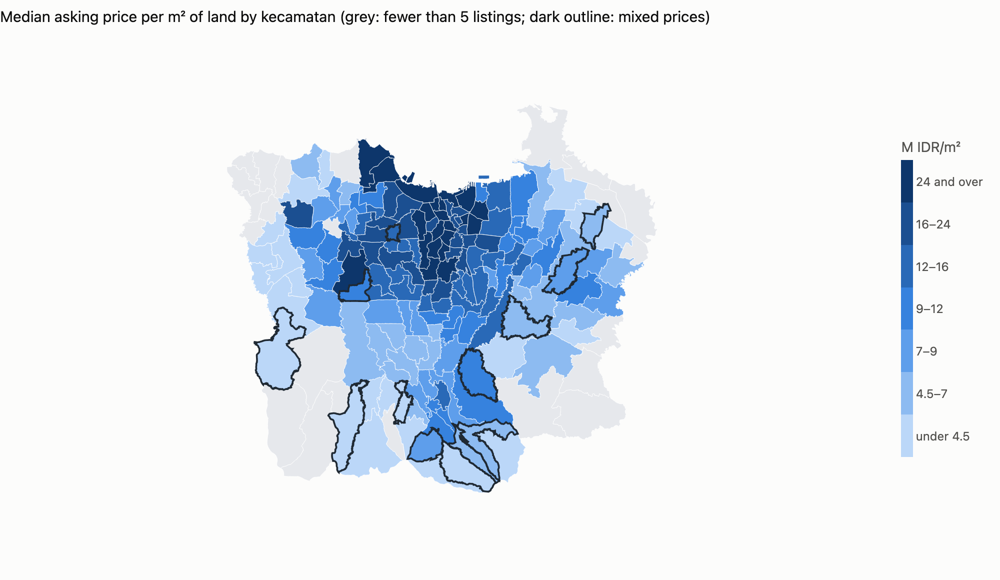
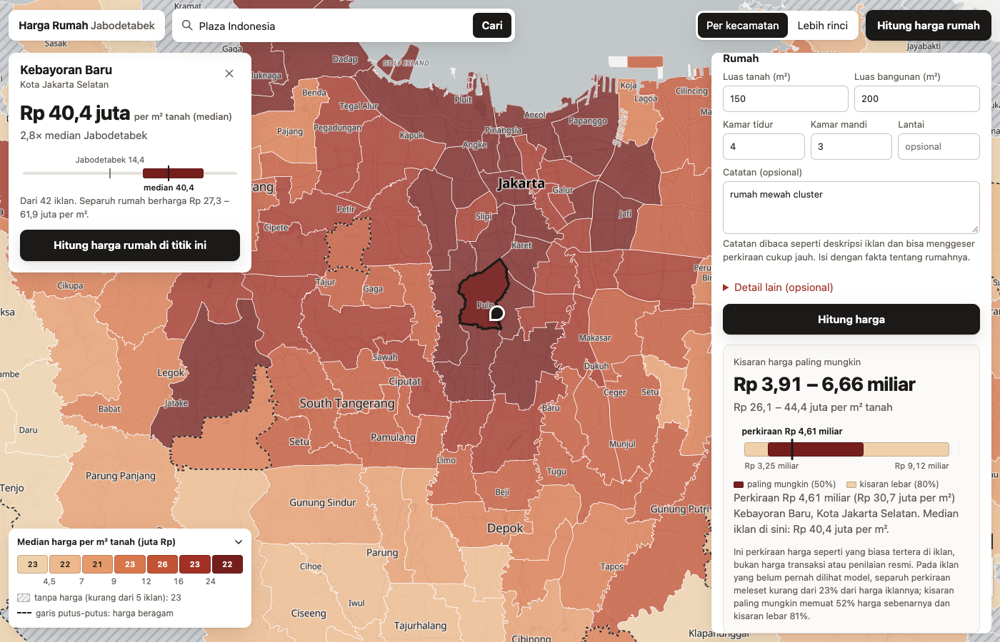
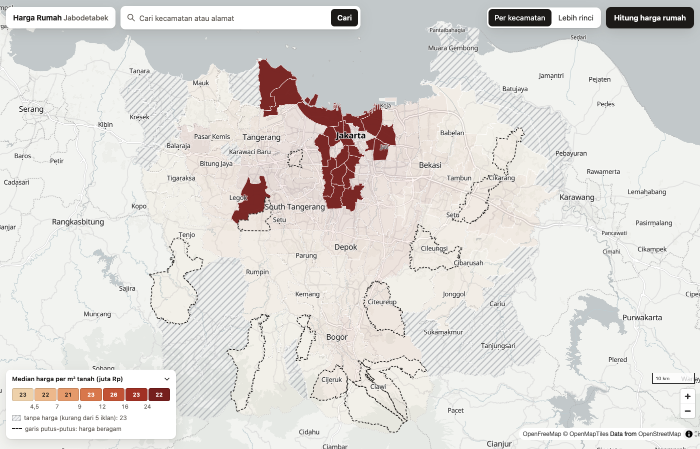
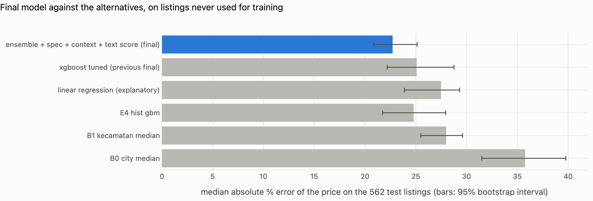
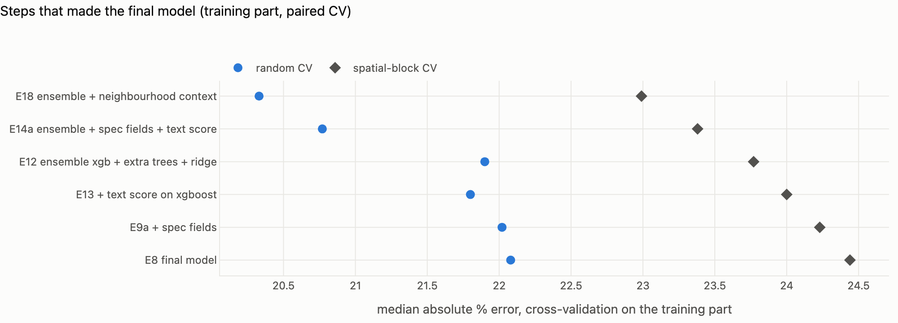

# Jabodetabek House Price

An asking-price map and estimator for houses in Jabodetabek (Jakarta, Bogor, Depok, Tangerang, Bekasi): where prices per m² of land sit,
and what a house like yours would ask, with an honest range around the number.

**Live demo:** coming soon (the site is built and tested; deployment comes next). **Model card:** [docs/model-card.md](docs/model-card.md).

## The site
A static page in Bahasa Indonesia (MapLibre on a free OpenStreetMap-based basemap, no build step). A full-screen map of the median price per m² of land by
kecamatan, with a finer H3 view; one warm sand-to-deep-red ramp in seven equal-count classes; hatched areas where there are too few listings to show a
price; dashed outlines where prices are mixed. The legend is interactive: point at a tier and everything else fades, so "where are the expensive areas" is
answered without reading numbers. Selecting an area pins a card that compares its middle half of prices with the Jabodetabek median.

Search matches kecamatan names while you type (from the map data itself) and looks up addresses and places only when you press Enter, through the free
OpenStreetMap geocoder, whose policy forbids search-as-you-type: results are cached and requests are spaced at least a second apart. The estimate panel
takes a pin from a click, a search result or the browser's location, calls the model API and shows the likely range, the wide range and the estimate on one
bar, with the price per m² underneath and warnings translated from codes the API returns. A browser test drives all of this in real Chrome, including a
phone ([web/](web/)).

## Result
## Result
On 562 listings the final model never saw (set aside before the final model was chosen, scored once):

| | Median error | 95% interval |
|---|---|---|
| **Final model** | **22.7%** | 20.9 to 25.1% |
| Previous single XGBoost | 25.1% | 22.2 to 28.8% |
| Kecamatan median (best simple baseline) | 28.0% | 25.5 to 29.6% |
| City median | 35.8% | 31.5 to 39.8% |

The estimate comes with a likely range (50%) and a possible range (80%). On the holdout they covered 52.3% and 80.6% of actual
prices, close to their targets. The error is mostly information, not algorithm: listings carry no photos, condition or street width,
and the same house listed twice differs by only about 6%, so the limit is what the data can tell, not agent noise.

## What I did and why it can be trusted
- **Honest validation.** Random 5x5 CV and spatial-block CV (11 km blocks, because price similarity vanishes by about 10 km) reported
  together. Every comparison is paired on identical folds, and a change is adopted only if it wins in at least 4 of 5 repeats under
  both schemes. The final holdout was set aside before model selection and scored once; an earlier test set had already been spent on an
  earlier model, so the final one comes from newer listings.
- **Audits after the score.** Same-house leakage (listings of one house on both sides of a split) costs 0.1 to 0.3 points; a time-based
  backtest shows no staleness within one to four months; the model beats the portal's own price estimate overall (20.1% against
  23.4% on the same listings), though that estimate may have seen the asking price.
- **Ideas that did not work are kept in the record.** Neighbour prices, size ratios, population and wealth rasters, filling missing
  floors, land title: each tried, measured and dropped ([reports/tables/experiments.csv](reports/tables/experiments.csv)).

- **Model.** Mean of XGBoost, extra trees and ridge on 48 features (distances to rail, busway and Monas, OpenStreetMap context such as
  roads and land use within 500 m, size and rooms, agent-filled specs) plus a text score from the title and description. Target is
  log price per m² of land, so the price is land area times the prediction.
- **Ranges.** Split-conformal ranges from out-of-fold spatial errors, by city, with a wider band for plots over 300 m².
- **Error analysis.** The worst 10% of listings carry 40% of the error: the cheapest quarter is over-predicted, plots over 300 m² are
  hardest, and listings with missing floors are noisier ([error analysis](reports/tables/error_analysis.csv)).
- **Serving.** A FastAPI service computes the same features as training (a parity test checks 40 real listings to 1e-9), answers in
  about 50 ms, validates input, rate-limits and restricts browser origins. It is packaged as a Docker image of about 300 MB compressed and
  gives the same estimate on macOS and Linux.
- **Monitoring.** A weekly health report scores the live model on newly listed houses (the asking price is known at once) with
  alerts for error, bias, input drift and parse failures, tested by a quiet replay and a forced failure
  ([example](reports/figures/weekly_error.png)).
- **Engineering.** 45 tests, CI on Google Cloud Build, locked dependencies, a model card and an architecture decision record.

## Data
Listings from an Indonesian property portal (about 4,000 usable houses over 17 months, collected politely: 3 s per request, identifying
User-Agent, stopping at any gate), OpenStreetMap (ODbL), official BIG administrative boundaries and BNPB flood hazard. **No
listing-level data, descriptions or page contents are published, here or on the site**: only kecamatan and H3 aggregates with at least 5
listings per area, and model estimates. The crawler is not part of this repository.

## Limits
- Asking prices, not transaction prices; asking prices run above what houses sell for.
- Listings whose slug names only a street or a cluster are under-sampled, and 23 kecamatan have fewer than 5 listings.
- The text score is the strongest input and is learned from full descriptions, so a short note typed into the form is a weak signal.
- The data holds only still-active listings (older ones have mostly sold), so slow-selling houses may be over-represented.

## Repository
`src/features` (distances, OSM context, kecamatan lookup), `src/modeling` (ensemble, CV, ranges, evaluation, experiments),
`src/analysis` (reports, audits, backtest), `src/pipeline` (drift checks, weekly report), `src/serving` (estimator and API),
`tests/`, `reports/figures` and `reports/tables` (aggregate results only). The data and the crawler are not included, so the code is
for reading and does not run end to end.
